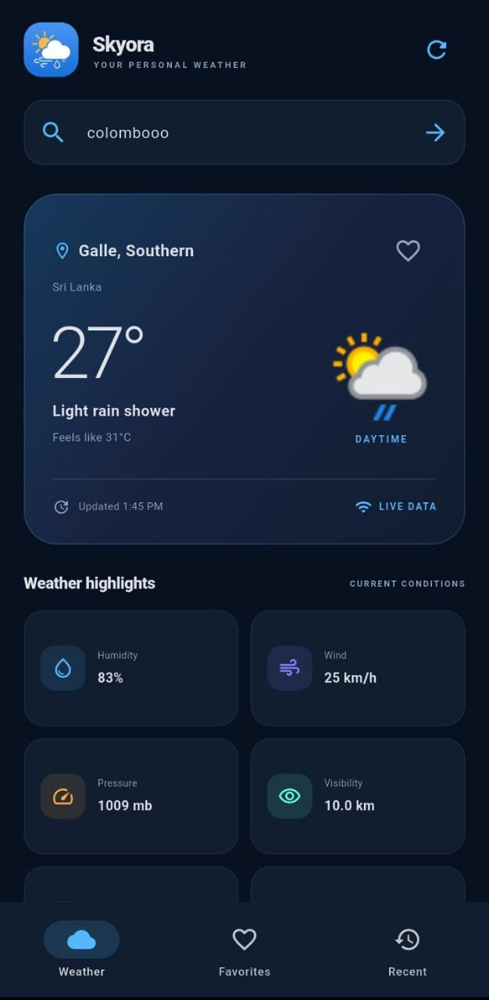
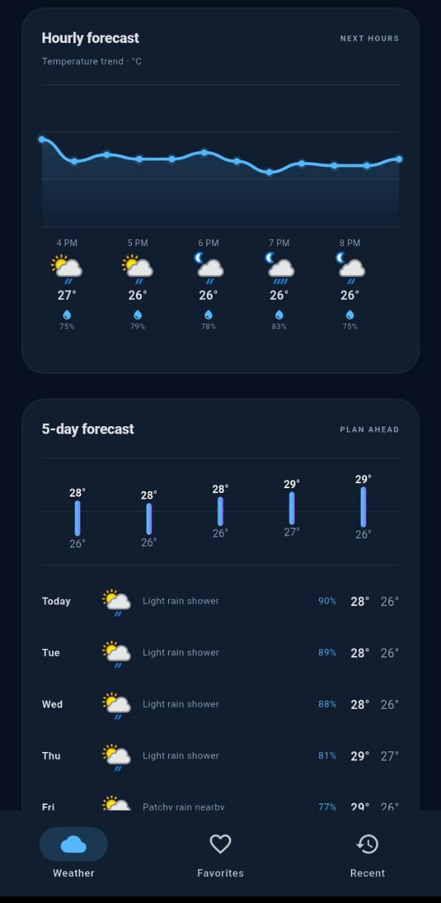

# Skyora — Weather Forecast App

<p align="center">
  
</p>

<h3 align="center">Your weather, beautifully in view.</h3>

<p align="center">
  A modern Flutter weather app to explore current conditions and forecasts for your city.
</p>

<p align="center">
  
  
  
  
</p>

---

## 📱 App Preview

<p align="center">
  
  
</p>

## ✨ Features

- 🔍 Search weather by city
- 🌡️ View current weather conditions
- 🕒 Check hourly weather forecasts
- 📅 Explore multi-day forecasts
- ⭐ Save favorite cities
- 🕘 Access recently searched cities
- 🌐 Retrieve weather information using an online API
- ⚠️ Handle network and API errors
- 🎨 Custom Skyora branding and launcher icon

## 🛠️ Tech Stack

| Technology | Purpose |
|---|---|
| Flutter | Cross-platform application framework |
| Dart | Application programming language |
| WeatherAPI.com | Weather and forecast data |
| HTTP | API requests |
| flutter_dotenv | Environment configuration |
| shared_preferences | Local preference storage |

## 🚀 Getting Started

### Prerequisites

- Flutter SDK installed
- Dart SDK
- Internet connection
- WeatherAPI.com API key

### 1. Clone the repository

Replace the URL below with your GitHub repository URL.

```bash
git clone YOUR_GITHUB_REPOSITORY_URL
cd weather_forecast_app
```

### 2. Install dependencies

```bash
flutter pub get
```

### 3. Configure your API key

Create a `.env` file in the root directory of the project.

Add your WeatherAPI key:

```env
WEATHER_API_KEY=your_weatherapi_key_here
```

Get an API key from [WeatherAPI.com](https://www.weatherapi.com/).

> **Security:** Never commit your real `.env` file or expose your API key publicly. The `.gitignore` file excludes environment files.

### 4. Run the application

Run on a connected device or emulator:

```bash
flutter run
```

Run in Google Chrome:

```bash
flutter run -d chrome
```

## 🧪 Quality Checks

The developer previously reported:

- `flutter analyze` completed without issues.
- `flutter test` passed one widget test.
- Weather search and forecast features were manually tested.

Automated test coverage may not include every application feature.

## 📂 Project Structure

```text
weather_forecast_app/
├── android/
├── assets/
│   └── skyora_logo.png
├── ios/
├── lib/
├── linux/
├── macos/
├── screenshots/
│   ├── skyora-preview-1.jpeg
│   └── skyora-preview-2.jpeg
├── test/
├── web/
├── windows/
├── .gitignore
├── pubspec.yaml
├── pubspec.lock
└── README.md
```

## 🌦️ Weather Data

Weather information is provided by [WeatherAPI.com](https://www.weatherapi.com/).

## 🔐 Security

- Keep API keys private.
- Do not commit `.env` files containing secrets.
- Store credentials in local environment configuration.

---

<p align="center">
  <strong>Skyora — Look up. Stay informed.</strong>
</p>